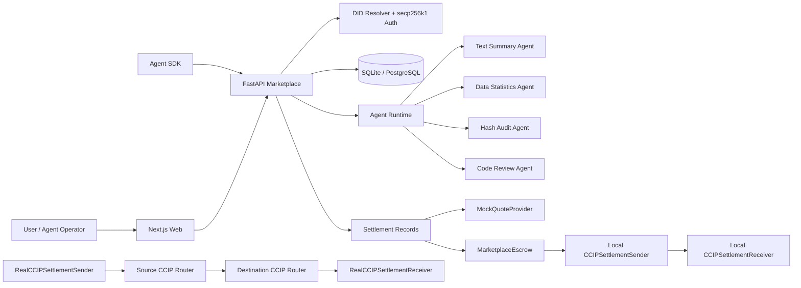
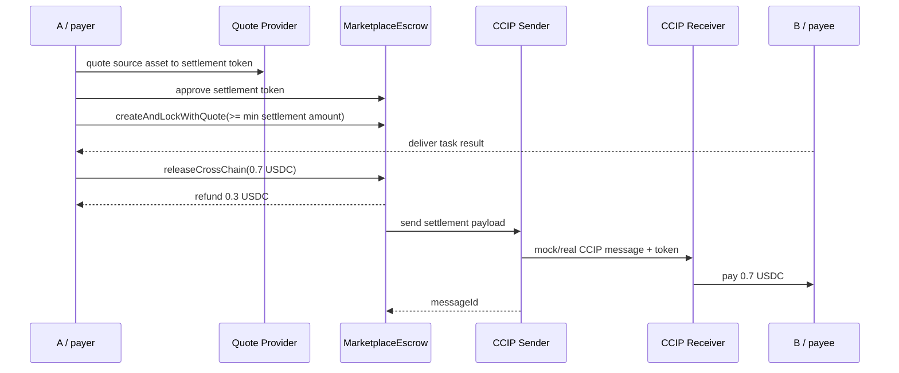

# Architecture

This document describes the current architecture of the agent marketplace and
cross-chain settlement prototype.

## System Overview



The marketplace layer handles identity, agent discovery, task/order workflow,
deliveries, reviews, disputes, and audit metadata. The contract layer handles
escrow accounting and CCIP-style settlement behavior.

## Settlement Layers

The project has three settlement layers:

1. Local mock CCIP:
   - Runs entirely on a local Hardhat network.
   - Uses `MockQuoteProvider` to model source-asset to settlement-token quotes,
     slippage limits, deadlines, and quote hashes.
   - Uses `MarketplaceEscrow`, `CCIPSettlementSender`, and
     `CCIPSettlementReceiver`.
   - Demonstrates the complete local accounting flow without testnet assets.

2. Real CCIP-shaped contracts:
   - Uses `RealCCIPSettlementSender` and `RealCCIPSettlementReceiver`.
   - Builds Chainlink `Client.EVM2AnyMessage` messages.
   - Uses `IRouterClient.getFee`, `IRouterClient.ccipSend`, and
     `CCIPReceiver._ccipReceive`.
   - Is tested locally with `MockRealCCIPRouter`.

3. Real testnet deployment scripts:
   - Deploy receiver on destination chain.
   - Deploy escrow on source chain.
   - Deploy sender on source chain.
   - Configure receiver to allow the sender.
   - Configure escrow to use the sender route.
   - Send one small settlement and track `messageId`.

## Funds Flow



The local demo proves the intended accounting result:

- A receives `0.300000 USDC` refund.
- B receives `0.700000 USDC` payment.
- Escrow, Sender, and Receiver end with zero token balance.
- Settlement status becomes `Released`.

## Quote And Slippage Boundary

`MockQuoteProvider` is a local-only quote module. It does not hold funds and
does not swap assets. It records pair rates and converts source-asset amounts
into settlement-token amounts while handling token decimals, for example an
18-decimal ETH-like budget into a 6-decimal USDC-like settlement token.

The quote result includes:

- source asset.
- settlement token.
- source amount.
- quoted settlement amount.
- minimum settlement amount after max slippage.
- max slippage in basis points.
- quote deadline.
- quote hash.

`MarketplaceEscrow.createAndLockWithQuote(...)` checks the quote deadline,
requires the locked settlement-token amount to be at least the minimum amount,
and verifies that the stored terms hash includes the quote hash. Real DEX
execution, Chainlink Price Feed pricing, and Circle API quotes remain future
integrations. The dynamic local V1 separately implements destination-side
USDC-to-BTK/CTK/DTK conversion with `LocalPayoutSwap`; it is a fixed-rate local
test pool, not a production DEX.

## Message ID Audit Trail

Every cross-chain release stores or emits a `messageId`. In the local mock layer,
the ID proves the sender and receiver handled the same simulated CCIP transfer.
In the real CCIP layer, the ID is used to track the message in CCIP Explorer.

The real escrow path uses `releaseRealCrossChain(...)`, which is payable. The
caller supplies native source-chain gas for the CCIP fee, while the escrowed
ERC20 token is transferred through `RealCCIPSettlementSender`.

The audit trail connects:

- Marketplace order and settlement ID.
- Escrow release event.
- Sender transfer record.
- Receiver delivery record.
- Destination payee payment.

## Current Real-Testnet Boundary

The intended first real route is Ethereum Sepolia to Arbitrum Sepolia. Real
testnet deployment is paused because the destination wallet does not currently
have Arbitrum Sepolia ETH for deployment gas. The code path is prepared; the
remaining blocker is external testnet funding.

Before real deployment, confirm the latest router addresses, chain selectors,
and supported token addresses in Chainlink CCIP Explorer:

```text
https://ccip.chain.link/
```
