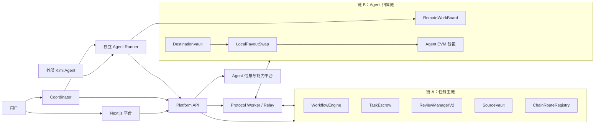

# 动态多链 Agent 工作流系统总体流程与资金节点化分布式结算机制

> 当前项目：`D:\agent-crosschain-platform-experiment-v2`  
> 文档日期：2026-08-06  
> 系统定位：动态多链 Agent 工作流协议的本地可运行实现、外部 Agent 接入验证和受控实验原型

## 1. 当前系统总体定位

当前系统是一个面向动态多链 Agent 工作流的本地实验系统，已经支持：

```text
外部 Agent 接入
-> 身份和钱包验证
-> 能力匹配
-> DAG 工作流执行
-> Agent 独立签名
-> 归属链结果提交
-> 跨链结果回传
-> 风险审核
-> 节点级资金结算
-> 目标链资产兑换
-> 失败换 Agent/换链
-> 迟到结果拒绝
-> 账本守恒核对
```

当前已经完成本地协议闭环和独立 Kimi Agent 端到端验收，但还没有完成真实公共测试网 CCIP、真实 DEX、真实 VRF 和生产安全审计。

当前可以准确声称：

> 系统已经在受控本地多链环境中完成外部 Agent 登记、身份和钱包验证、DAG 节点执行、跨链结果传递、风险审核、目标链资产兑换、节点级结算和失败恢复。

当前不能声称：

- 已经完成公共测试网真实 CCIP 交付；
- 已经在生产环境处理真实资产；
- 已经形成完全开放和去中心化的 Agent 市场；
- 本地 Relay 的安全性等同于 Chainlink DON；
- 本地测试 Token 具有现实经济价值；
- `resultHash` 能证明 Agent 输出在语义上一定正确；
- 多条独立区块链能够执行传统数据库式整体回滚。

## 2. 系统总体架构



系统分为五层：

| 层级 | 组件 | 作用 |
|---|---|---|
| 用户层 | Web、聊天页面、用户钱包 | 创建任务、确认 DAG、锁定预算、查看结果 |
| 控制层 | Platform API、Coordinator、Agent 信息平台 | Agent 登记、能力匹配、工作流状态推进 |
| Agent 层 | Kimi、Runner、工具、身份密钥、EVM 钱包 | 执行任务、签署结果、提交链上交易 |
| 合约层 | Workflow、Escrow、Review、Vault、DEX | 保存关键状态、控制审核和资金 |
| 跨链层 | Worker、Relay、Sender、Receiver | 读取事件、跨链投递、重试和确认 |

## 3. 四条本地链的职责

| 链 | chainId | 作用 |
|---|---:|---|
| 链 A | `31337` | 工作流、DAG、Escrow、审核、资金预留、源链结算 |
| 链 B | `31338` | 成功 Agent 和 Kimi 的归属链、结果提交、BTK 付款 |
| 链 C | `31339` | 第一次失败 attempt，验证审核失败、超时和迟到结果 |
| 链 D | `31340` | C 失败后动态接入，由备用 Agent 完成 attempt 2 |

四条链是四个相互独立的 EVM 账本，不是四个测试用户。每条链具有独立 RPC、`chainId`、区块、合约状态和账户余额。

Coordinator 是链下服务，主要协调链 A 上的工作流，不需要单独占用一条链。

## 4. Agent 的组成和接入流程

一个完整的外部 Agent 由以下部分组成：

```text
大语言模型或确定性程序
+ Agent Runner
+ 受控工具
+ Agent 身份私钥
+ EVM 钱包私钥
+ Manifest
+ 输入/输出 JSON Schema
+ 平台心跳配置
```

接入流程为：

```text
Agent 所有者启动 Runner
-> 平台读取 /health
-> 平台读取 /manifest
-> 提交 Agent、DID、能力、endpoint、homeChainId、homeWallet
-> Agent 身份私钥签署 challenge
-> EVM 钱包使用 EIP-191 证明钱包所有权
-> 管理员执行测试 invoke
-> 验证结果签名
-> 检查 Route 和 Gas
-> 管理员批准
-> Runner 发送签名心跳
-> Agent 进入 matchable 状态
```

### 4.1 Agent 状态机制

| 状态 | 含义 |
|---|---|
| `admissionStatus` | 平台审核状态 |
| `chainStatus` | 归属链和 Route 状态 |
| `availability` | Runner 在线状态 |
| `gasReady` | 钱包 Gas 状态 |
| `capacityAvailable` | 当前任务容量 |
| `credentialStatus` | 身份凭证状态 |
| `matchable` | 最终可匹配状态 |

概念上的匹配条件为：

```text
matchable = admission approved
         && chain ready
         && availability online
         && capacity available
         && gas ready
         && credential active
         && active route exists
```

如果 Agent 审核通过但链路尚未准备好，它进入 `PENDING_ROUTE`，而不是被判定为审核失败。

## 5. Agent 的两套密钥

| 密钥 | 用途 |
|---|---|
| Agent 身份私钥 | 签署 task offer、结果、心跳和身份 challenge |
| EVM 钱包私钥 | 提交归属链交易、支付 Gas、接收 Token |

两套密钥不能混用。

身份签名证明哪个 Agent 产生了结果；钱包签名证明哪个链上账户提交了结果并接收结算资金。

Worker 不持有 Agent 钱包私钥。Runner 检查交易目标、方法、`attemptId`、Gas、nonce 和金额后自行签名。

## 6. 当前独立 Kimi Agent

当前完成端到端验收的外部 Kimi 为：

```text
agentKey:    workflow-research-kimi-external-v2
DID:         did:local:workflow-research-kimi-external-v2
homeChainId: 31338
homeWallet:  0xAd177d6A3cefA702811EB08f1EF4FE59c4da8A03
```

当前已经验证：

- 连续对话；
- 项目文档检索；
- `research` 结构化任务；
- 真实 Kimi 模型调用；
- task offer 接收；
- ES256K 结果签名；
- EVM 钱包所有权证明；
- 链 B 结果交易；
- 签名心跳；
- 能力市场发布；
- 本地 BTK 收款。

当前 Kimi 还没有通用浏览器、任意终端、任意文件修改和无限制互联网工具。这是 Agent 工具范围限制，不是跨链协议限制。

## 7. 用户任务完整执行流程

### 7.1 用户描述需求

用户向 Coordinator 描述任务。当前 Coordinator 已经可以生成和推进工作流，但核心仍是确定性规则或 Mock Provider，不是最终的 LLM 用户协调 Agent。

### 7.2 生成 DAG

Coordinator 将任务拆分为多个节点。每个节点包含：

```text
输入
输出
能力要求
前置依赖
验收条件
风险等级
预算
```

第一版在用户确认后冻结 DAG，工作流执行期间不随意修改节点结构。

### 7.3 锁定总预算

用户在链 A 的 `TaskEscrow` 锁定总预算和必要的 Gas 预算。系统不会一次性向所有 Agent 付款。

### 7.4 启用节点

只有当前置节点已经 `SETTLED`，后续节点才可以启用。前置 Agent 仅返回结果不足以启用后续节点，必须确认审核和付款已经完成。

### 7.5 匹配 Agent

Coordinator 先执行硬条件过滤：

```text
能力匹配
审核通过
Runner 在线
有任务容量
Gas 就绪
报价未过期
报价不超过预算
凭证有效
Route 可用
收款资产兼容
```

再按照价格、成功率、信任分、延迟、当前负载、Route 成本和优先级评分。

系统保存 Top-K 候选快照，但只有最终选中的 Agent 创建 attempt 和资金 reservation。

### 7.6 创建 attempt

系统冻结：

```text
nodeId
attemptId
agentId
homeChainId
homeWallet
routeId
routeVersion
reservationId
报价
deadline
nonce
criteriaHash
reviewPolicyHash
```

`nodeId` 表示稳定业务节点，`attemptId` 表示某个 Agent 对该节点的一次具体执行。

### 7.7 发送任务

链 A 发出 `DISPATCH` 事件。Relay 等待确认块数后，将任务发送到 Agent 归属链的 `RemoteWorkBoard`。

### 7.8 Agent 执行

Runner 验证 task offer 签名、Agent 身份、`attemptId`、deadline、nonce、输入 Schema、预算和 Route，然后调用 Kimi、DeepSeek、确定性程序或受控工具执行任务。

### 7.9 结果签名

```text
输出 Schema 验证
-> 计算 outputHash
-> 计算 resultHash
-> Agent 身份密钥签名
-> Agent EVM 钱包签署结果交易
-> 在归属链提交 submitResult
```

### 7.10 结果回传

归属链产生结果事件。Relay 发送 `RESULT_PROOF` 回链 A，消息包含 `workflowId`、`nodeId`、`attemptId`、`resultHash`、`proofHash`、`routeVersion` 和 `messageId`。

### 7.11 风险审核

链 A 固定 `resultHash`、`proofHash` 和 `reviewPolicyHash`，然后根据风险等级进入自动审核、抽样审核、挑战期或仲裁。

### 7.12 创建结算

只有审核最终通过，才会创建 `SETTLEMENT`。审核通过不等于已经支付。

### 7.13 目标链付款

```text
DestinationVault 释放资产
-> DEX 兑换
-> 检查 minAmountOut
-> Agent 钱包到账
-> 发出付款事件
```

### 7.14 源链确认

Worker 验证目标链付款事件，链 A 确认结算完成。只有此时 attempt 和 node 才进入 `SETTLED`。

### 7.15 工作流结束

所有节点完成后，工作流进入 `COMPLETED`，平台费用入账，剩余预算和 Gas 退款，并执行账本守恒核对。

## 8. 审核和验证机制

### 8.1 LOW 风险

使用 JSON Schema、格式规则、确定性验收条件、结果哈希和 Agent 签名。规则满足后可以自动审核。

### 8.2 MEDIUM 风险

结果固定后执行随机抽样：

```text
randomWord % 10000 < samplingRateBps
```

抽中则由独立 Reviewer 复核；未抽中则按照预设规则推进。当前本地使用 Mock 随机数，还不是真实 Chainlink VRF。

### 8.3 HIGH 风险

```text
多个 Reviewer EIP-712 签名
-> 达到审核阈值
-> 开启链上挑战期
-> 挑战期内禁止付款
-> 无挑战则到期 finalize
-> 有挑战则进入 DISPUTED
-> 多个 Arbitrator 投票
-> 达到阈值后批准或拒绝
```

EIP-712 签名绑定 `workflowId`、`nodeId`、`attemptId`、`resultHash`、`reviewPolicyHash`、decision、evidenceHash、nonce、deadline、`chainId` 和 ReviewManagerV2 地址。

因此审核签名不能跨链、跨合约或跨 attempt 重放。

## 9. 跨链消息机制

| 消息 | 方向 | 作用 |
|---|---|---|
| `DISPATCH` | A -> B/C/D | 发送任务 |
| `RESULT_PROOF` | B/C/D -> A | 回传结果证明 |
| `SETTLEMENT` | A -> B/C/D | 发起付款 |

每条消息绑定：

```text
messageId
sourceChainId
destinationChainId
sourceSender
targetReceiver
workflowId
nodeId
attemptId
routeId
routeVersion
payloadHash
nonce
```

Receiver 检查源链、Sender 白名单、Route 版本、当前 attempt、payload hash、`messageId` 和 nonce。

## 10. Relay 和故障恢复机制

Local Relay 只读取链上事件，不直接修改数据库伪造消息交付。

```text
源链事件
-> 等待确认块数
-> 写入 SQLite 队列
-> 调用目标链 Receiver
-> 等待交易回执
-> 保存交易哈希
-> 更新交付状态
```

当前支持 Relay 崩溃重启、SQLite 游标恢复、重复消息、RPC 中断、延迟投递、attempt 乱序、Worker 在确认前退出和重复付款防护。

Local Relay 用于验证协议状态机，不等于真实 Chainlink CCIP。

## 11. 主要智能合约

### 11.1 `WorkflowEngine`

负责保存工作流、DAG 节点状态、当前 attempt、前置依赖和节点结算状态，并阻止旧 attempt 修改当前节点。

### 11.2 `TaskEscrow`

负责锁定用户总预算、创建节点 reservation、失败释放、成功结算、平台费限制、剩余预算退款和重复付款防护。

### 11.3 `ChainRouteRegistry`

负责保存支持的链、源链与目标链 Route、Route 版本、Sender、Receiver、Vault 和 Token 地址，并支持链 D 运行时接入。

### 11.4 `RemoteWorkBoard`

部署在 Agent 归属链，负责接收跨链任务、保存 attempt、接收 Agent 钱包提交的结果并发出结果事件。

### 11.5 `ResultProofGateway`

负责接收归属链回传的结果证明，并将 `resultHash` 和 `proofHash` 与链 A 的 attempt 关联。

### 11.6 `ReviewManagerV2`

负责 EIP-712 Reviewer 签名、防重放、审核阈值、链上挑战时间锁、争议状态、Arbitrator 多签和 `isSettlementAllowed(attemptId)` 结算门禁。

### 11.7 `DynamicSettlementSender`

部署在链 A，负责构造结算消息、绑定 attempt 和 settlement、冻结结算参数并防止同一 settlement 重复发送。

### 11.8 `DynamicSettlementReceiver`

部署在目标链，负责检查源链、Sender、Token、金额、`messageId`、Route，并调用 DestinationVault 和 DEX。

### 11.9 `SourceVault`

负责保存或锁定源链结算资产，并维护跨链资金 backing。

### 11.10 `DestinationVault`

提前持有目标链结算资产。收到合法 settlement 后从预充值资金中释放，而不是在付款时任意铸币。

### 11.11 `LocalPayoutSwap`

本地目标链兑换合约，支持流动性储备、不同 decimals、报价、汇率、`minAmountOut`、deadline、滑点和流动性不足回滚。它不是真实 Uniswap 或 0x 流动性。

### 11.12 `GasTreasuryA` / `ResultRelayGasVault`

负责区分业务 Token 和 Gas 资产，保存派发、Relay 和结算所需的 Gas 预算。

### 11.13 `FeePolicy`

限制平台费用，防止 Coordinator 把所有剩余预算计为平台费。

### 11.14 `FailureClassifier`

区分 Agent 失败、审核失败、RPC 失败、Relay 失败、DEX 失败和系统失败，避免把基础设施故障错误处罚为 Agent 信誉问题。

### 11.15 Real CCIP 合约

项目还包含 `RealCCIPSettlementSender`、`RealCCIPSettlementReceiver` 和 `MarketplaceEscrow`。

真实 Sender 使用：

```text
IRouterClient.getFee
IRouterClient.ccipSend
Client.EVM2AnyMessage
```

真实 Receiver 继承 Chainlink `CCIPReceiver`。这些合约已经通过本地 Mock Router 测试，但还没有公共测试网交付证据。

## 12. 使用的技术

| 范围 | 技术 |
|---|---|
| 前端 | Next.js、React、TypeScript |
| 后端 API | Python、FastAPI |
| Coordinator | FastAPI、确定性规则、可扩展 LLM Provider |
| Agent Runner | FastAPI、Kimi/DeepSeek、JSON Schema |
| Worker | Node.js、TypeScript、viem |
| 智能合约 | Solidity、OpenZeppelin、Chainlink CCIP |
| 本地链 | Hardhat |
| 固定出块实验 | Hyperledger Besu、Docker Compose |
| 数据库 | SQLite；容器方案包含 PostgreSQL |
| 缓存 | Redis |
| 结果存储准备 | MinIO |
| Agent 身份 | DID、ES256K、secp256k1 |
| 钱包验证 | EIP-191 |
| 审核和仲裁 | EIP-712 |
| 内部认证 | Bearer Token、HMAC、nonce、时间窗 |
| 自动化 | PowerShell、pnpm、Hardhat scripts |

## 13. 资金节点化分布式结算机制

英文名称：

> **Node-Oriented Distributed Fund Settlement Mechanism**

### 13.1 “节点化”的含义

用户不是为整个工作流一次性付款，而是将总预算按照 DAG 节点和具体 attempt 建立逻辑预留。

例如：

```text
N1：研究
N2：验证
N3：汇总
```

用户锁定总预算 `B`，但系统不会立刻向三个 Agent 付款。当 N1 启用时，只创建：

```text
Reservation(N1, Attempt1)
```

N1 完成审核和付款后，N2 才能启用。

### 13.2 “分布式”的含义

不同节点的 Agent、钱包和结算可能分布在不同区块链：

```text
N1 Agent -> 链 B
N2 Attempt1 -> 链 C
N2 Attempt2 -> 链 D
Workflow/Escrow -> 链 A
```

“分布式”不表示系统能够执行跨链数据库事务，而是表示执行状态、钱包和结算资产分布在不同账本中。

### 13.3 三个不同状态阶段

系统明确区分：

```text
任务执行完成
结果审核通过
目标资产到账
```

Agent 提交 `resultHash` 后，只能进入结果已提交状态，不能立即付款。

审核通过后，只代表允许结算，仍不代表 Agent 已经收到钱。

只有目标链钱包实际到账后，节点才进入 `SETTLED`。

### 13.4 总预算锁定

用户在链 A 锁定：

```text
TotalBudget
PlatformFeeCap
SourceGasBudget
工作流条款哈希
```

平台费用不能超过用户预先设置的 `platformFeeCap`。

### 13.5 节点预算预留

节点匹配 Agent 后创建：

```text
reservationId
nodeId
attemptId
agentId
reward
settlementAsset
deadline
```

预留的作用是：

- 保证当前 Agent 成功后有资金可付；
- 防止同一预算同时分配给多个 Agent；
- 失败时可以释放；
- 候选 Agent 不占用资金；
- 每个 attempt 的结算资格彼此隔离。

### 13.6 结果通过后的结算

```text
Reservation = RESERVED
-> Agent 执行
-> 结果审核 Approved
-> Reservation = SETTLEMENT_PENDING
-> 创建唯一 settlementId
-> 发送 SETTLEMENT
```

只有当前有效 attempt 可以创建 settlement。

### 13.7 源链资产处理

完整 V2 资金路径可以是：

```text
用户 TokenA
-> 源链 DEX
-> BridgeAsset
-> SourceVault 锁定
```

Kimi 当前验收使用较直接的 USDC 结算资产，再在目标链兑换为 BTK。

### 13.8 目标链资产处理

```text
DestinationVault 预充值结算资产
-> Receiver 验证 settlement
-> Vault 释放资产
-> DEX 兑换为 Agent 接受的 Token
-> Agent homeWallet 到账
```

目标链不能因为收到一条消息就任意铸造 ETH、BNB、SOL 或其他官方原生币。

### 13.9 到账确认

结算完成至少需要验证：

```text
settlementId 唯一
messageId 未处理
attemptId 当前有效
金额正确
payoutAsset 正确
payoutToken 正确
deadline 未过期
实际到账 >= minAmountOut
目标钱包正确
目标链交易达到确认数
```

完成后，目标链发出付款事件，源链再确认 attempt 和节点 `SETTLED`。

### 13.10 资金守恒

在同一种源链资产中，应满足：

```text
用户锁定总额
=
已支付节点源链成本
+ 平台费用
+ 用户退款
+ 尚未结算的有效预留
```

不同 Token 不能直接相加。例如 USDC 和 BTK 必须分别记账：

```text
PAYOUT      记录 USDC 结算腿
PAYOUT_SWAP 记录 BTK 兑换腿
```

对于 BridgeAsset，还应检查：

```text
SourceVault backing
=
各 DestinationVault 实际释放 BridgeAsset 总额
```

### 13.11 Agent 执行或审核失败

```text
Attempt -> FAILED/REVIEW_FAILED
Reservation -> RELEASED
Node -> RETRYING
Settlement message -> 不创建
Agent payment -> 0
```

Agent 已经消耗的归属链 Gas 不会回滚。

### 13.12 更换 Agent

系统保持 `nodeId` 不变，创建新 `attemptId`：

```text
N2 / attempt 1 / Agent-C / chain C
失败
N2 / attempt 2 / Agent-D / chain D
成功
```

新 attempt 使用独立 Agent、钱包、链、Route、reservation、deadline、nonce 和 settlementId。

### 13.13 迟到结果处理

当 attempt 2 生效后：

```text
attempt 1 返回迟到结果
-> 签名可能有效
-> 但不是 currentAttemptId
-> StaleAttempt
-> 不改变节点
-> 不创建 settlement
-> 不重复付款
```

### 13.14 DEX 失败

```text
SETTLEMENT 已到目标链
-> DEX 因滑点、deadline 或流动性不足失败
-> Agent 未到账
-> 节点保持 SETTLEMENT_PENDING
-> 资产留在 Vault
-> 更新 minAmountOut/deadline
-> 重新兑换
```

不能把兑换失败记录为已付款。

### 13.15 Relay 或 Worker 失败

Relay 使用持久化队列恢复，Receiver 使用 `messageId` 和 `settlementId` 防止重复支付。

```text
目标链已付款
-> Worker 在源链确认前崩溃
-> Worker 重启
-> 重新读取目标链付款事件
-> 只补做源链确认
-> 不再次付款
```

### 13.16 为什么不是全局原子结算

多条链无法同时回滚，所以系统把全局原子性转化为节点级属性：

- 每个 attempt 最多付款一次；
- 旧 attempt 永远不能付款；
- 未到账不能 `SETTLED`；
- 已完成节点不因后续失败回滚；
- 失败资金进入释放、留存、重试或补偿流程；
- 账本始终可以核对。

### 13.17 机制优点

1. 单个 Agent 失败不会撤销整个工作流；
2. 已完成 Agent 可以及时获得付款；
3. 失败节点可以换 Agent 和换链；
4. 预算不会同时分配给多个 attempt；
5. 迟到结果不能覆盖当前结果；
6. DEX 失败不会伪造到账；
7. 适合多阶段、长时间、跨组织任务；
8. 可以生成清晰的链上和链下审计记录。

### 13.18 机制缺点

1. 状态机和账本更加复杂；
2. 每个节点都会增加交易和 Gas；
3. 必须维护目标链流动性；
4. 到账确认会增加延迟；
5. 只能实现最终一致性；
6. 真实 CCIP 消息发送后不能普通取消；
7. 需要可靠的价格、DEX、RPC 和事件索引；
8. 高风险审核和仲裁会延长付款时间；
9. SourceVault 和 DestinationVault 失衡时需要治理补充资金。

### 13.19 当前验证实例

Kimi 端到端验收中：

```text
节点结算金额: 4.2 USDC
目标资产:     BTK
兑换率:       2
预期到账:     8.4 BTK
最低到账:     8.316 BTK
实际到账:     8.4 BTK
```

最终状态：

```text
workflow = COMPLETED
node = SETTLED
attempt = SETTLED
payoutStatus = SWAPPED
ledgerBalanced = true
```

这证明了本地环境中的节点预留、结果审核、跨链消息、目标兑换、钱包到账和最终结算闭环。

## 14. 当前主要缺口

1. 公共测试网真实 CCIP 端到端证据；
2. 公共测试网真实 VRF；
3. 真实 DEX 和可信价格来源；
4. 目标链事件证明和链重组确认；
5. Coordinator 的真实 LLM 用户交互能力；
6. Docker 外部 Agent 跨电脑验收；
7. Reviewer、Arbitrator 和 Route controller 多签治理；
8. Secret Manager/HSM 和正式认证；
9. 第三方智能合约安全审计；
10. 真实 Token 异常行为和流动性风险测试。

## 15. 推荐后续顺序

1. 冻结当前本地代码和验收证据；
2. 将独立 Kimi 构建为 Docker Agent；
3. 在第二台电脑完成登记、心跳、匹配和本地链结算；
4. 接入真实 LLM Coordinator，但保留确定性规则和合约门禁；
5. 使用 Besu 完成固定出块和故障注入实验；
6. 建立 Centralized、Single-chain 和 Proposed 对照；
7. 完成最小公共测试网 CCIP 交易；
8. 完成 Kimi 测试网结果提交和结算；
9. 接入真实 DEX 和价格来源；
10. 完成多签治理、密钥管理和第三方安全审计。

